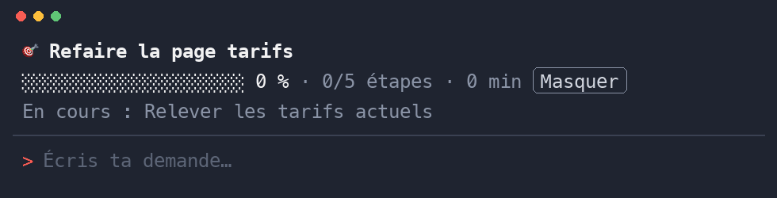

# objectif-sprint

[Français](README.md) · **English**

A Claude Code mod that shows your goal's progress above the prompt: the steps Claude planned, the share done, the time elapsed and the current step.



<sub>Drawn by Claude Code's own engine (test `tests/rendu.test.tsx`), turned into frames by `docs/fabriquer-gif.py`. Sped up (x4).</sub>

> [!NOTE]
> The mod's interface is in French ("étapes", "En cours", "Masquer"). The command is `/objectif`.

## Why

On a long task Claude already keeps a step list, but it scrolls away with the conversation. objectif-sprint keeps it in sight, on one line, with nothing to set up.

## Features

- **No setup**: the band fills itself from the task list Claude already keeps (TodoWrite, TaskCreate and TaskUpdate, or the Desktop app's plan).
- **One line**: bar, percentage, steps done out of total, current step.
- **Live timer**: the time ticks every second while work goes on, then freezes once everything is done.
- **Pinned goal**: `/objectif <text>` shows your goal as a title and restarts the timer.
- **Unobtrusive**: a "Masquer" (hide) button hides the band until the next list.
- **Safe**: read-only, no network call, no model call, so no tokens spent. An error in the band never blocks a tool.

## Requirements

- Claude Code 2.1.287 or later in the terminal, or 2.1.286 or later in the Claude Desktop app (Code tab).

> [!NOTE]
> Mods are not drawn in the VS Code extension.

## Install

In a Claude Code terminal session:

```
/plugin install objectif-sprint --marketplace vannina/claude-objectif-sprint
```

Answer `y` to add the marketplace, then pick a scope (user is the default, for all your sessions).

From a shell:

```bash
claude plugin install objectif-sprint --marketplace vannina/claude-objectif-sprint
```

In the Desktop app, where `/plugin` does not run: click **+** next to the prompt box, then **Plugins**, **Add marketplace** with `vannina/claude-objectif-sprint`, then **Add plugin**.

> [!TIP]
> Installed from a shell, the mod loads in sessions started afterwards. In a session already open, run `/reload-plugins`.

## Usage

Give Claude a multi-step task: as soon as it writes its task list, the band appears.

| Command | Effect |
|---|---|
| `/objectif Rebuild the pricing page` | Pins the goal as a title and restarts the timer |
| `/objectif fin` | Clears the goal and the band |
| **Masquer** button | Hides the band until the next list or the next `/objectif` |

> [!IMPORTANT]
> The goal and progress belong to the current session. A new session starts empty.

## Documentation (French)

- [How it works](docs/fonctionnement.md)
- [FAQ and troubleshooting](docs/faq.md)
- [Changelog](CHANGELOG.md)

## Test

```bash
claude plugin test .
```

## Uninstall

```bash
claude plugin uninstall objectif-sprint
```

Then, if nothing else uses it: `claude plugin marketplace remove claude-objectif-sprint`.

Author: Vannina Michelosi. MIT license.
