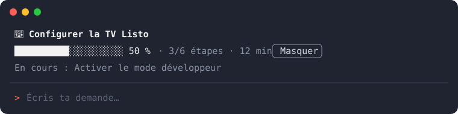

# objectif-sprint

**Français** · [English](README.en.md)

Un mod Claude Code qui affiche, au-dessus du prompt, la progression de ton objectif : les étapes prévues par Claude, le pourcentage fait, le temps écoulé et l'étape en cours.



## Pourquoi

Sur une tâche longue, Claude tient déjà une liste d'étapes, mais elle défile avec la conversation. objectif-sprint la garde sous tes yeux, en une ligne, sans rien te demander de configurer.

## Fonctionnalités

- **Zéro configuration** : la barre se remplit toute seule à partir de la liste de tâches que Claude tient déjà (TodoWrite, TaskCreate et TaskUpdate, ou la liste de l'appli Desktop).
- **L'essentiel en une ligne** : barre, pourcentage, étapes faites sur le total, temps écoulé, étape en cours.
- **Objectif épinglé** : `/objectif <texte>` affiche ton objectif en titre et relance le chrono.
- **Discret** : un bouton « Masquer » cache la barre jusqu'à la prochaine liste.
- **Sans risque** : lecture seule, aucun appel réseau, aucun appel au modèle, donc aucun token consommé. Une erreur de la barre ne bloque jamais un outil.

## Prérequis

- Claude Code 2.1.287 ou plus récent dans le terminal, ou 2.1.286 ou plus récent dans l'appli Claude Desktop (onglet Code).

> [!NOTE]
> Les mods ne s'affichent pas dans l'extension VS Code.

## Installation

Dans une session Claude Code, au terminal :

```
/plugin install objectif-sprint --marketplace vannina/claude-objectif-sprint
```

Réponds `y` pour ajouter le marketplace, puis choisis la portée (user par défaut, pour toutes tes sessions).

Depuis un shell :

```bash
claude plugin install objectif-sprint --marketplace vannina/claude-objectif-sprint
```

Dans l'appli Desktop, où `/plugin` ne s'exécute pas : bouton **+** à côté du champ de saisie, puis **Plugins**, **Add marketplace** avec `vannina/claude-objectif-sprint`, puis **Add plugin**.

> [!TIP]
> Installé depuis un shell, le mod se charge dans les sessions ouvertes ensuite. Dans une session déjà ouverte, lance `/reload-plugins`.

## Utilisation

Donne à Claude une tâche en plusieurs étapes : dès qu'il pose sa liste de tâches, la barre apparaît.

| Commande | Effet |
|---|---|
| `/objectif Refaire la page tarifs` | Épingle l'objectif en titre et relance le chrono |
| `/objectif fin` | Efface l'objectif et la barre |
| Bouton **Masquer** | Cache la barre jusqu'à la prochaine liste ou au prochain `/objectif` |

> [!IMPORTANT]
> L'objectif et la progression valent pour la session en cours. Une nouvelle session repart de zéro.

## Documentation

- [Fonctionnement](docs/fonctionnement.md) : d'où viennent les étapes, règles du chrono, ce que le mod lit et ne fait pas.
- [FAQ et dépannage](docs/faq.md)
- [Historique des versions](CHANGELOG.md)

## Désinstaller

```bash
claude plugin uninstall objectif-sprint
```

Puis, si tu n'en as plus besoin : `claude plugin marketplace remove claude-objectif-sprint`.

## Structure

```
.claude-plugin/
  plugin.json        manifeste du mod
  marketplace.json   rend le dépôt installable en une ligne
hooks/
  hooks.json         déclare le module
  register.tsx       le mod : commande /objectif, lecture des tâches, barre
types/
  index.d.ts         contrat de l'état de session ($.state)
docs/                documentation et aperçu
```

Autrice : Vannina Michelosi. Licence MIT.
